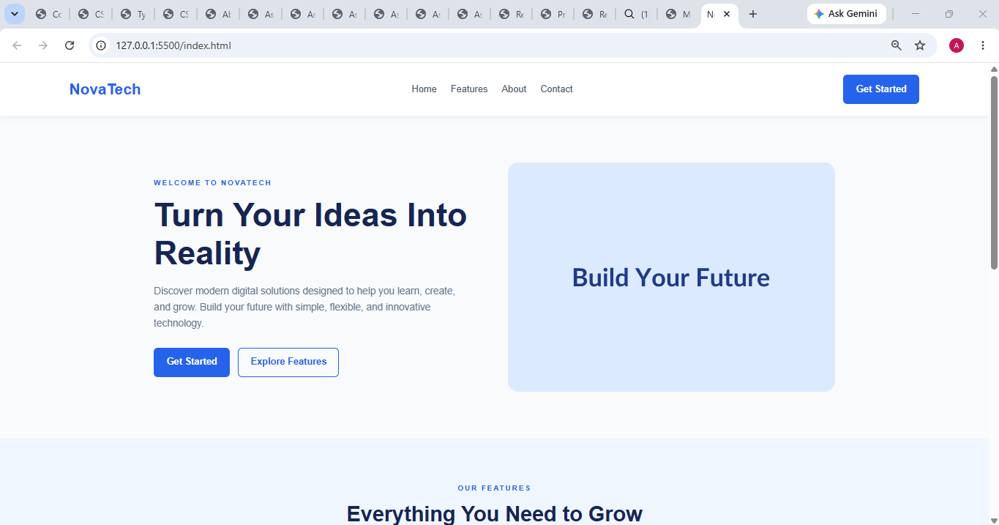
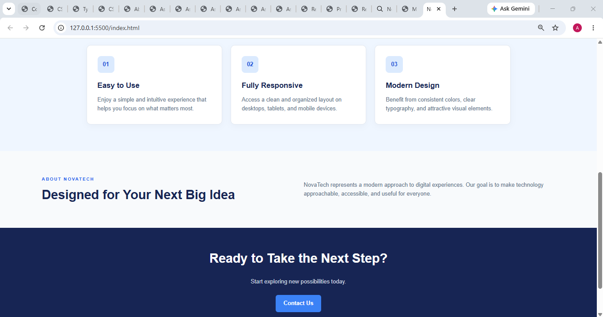

# Assignment 7.5 — Flexbox Mini-Project

## 1. Aim

To develop a complete responsive landing page using HTML, CSS, and Flexbox, containing a navigation bar, hero section, three feature cards, a call-to-action section, and a footer.

## 2. Requirements

- Visual Studio Code
- A web browser
- Basic knowledge of HTML and CSS
- Git and a GitHub account for submission

## 3. Theory

Flexbox is a CSS layout model used to arrange webpage elements in rows or columns. It makes it easier to align content, distribute space, and build responsive layouts.

The `display: flex` property enables Flexbox. The `justify-content` property distributes items along the main axis, while `align-items` aligns items along the cross axis. The `gap` property adds spacing, and `flex-wrap` allows elements to move onto another line when space is limited.

Responsive design uses flexible dimensions and media queries to ensure that a webpage works on desktop, tablet, and mobile screens.

## 4. Procedure

1. Create a project folder named `Assignment-7.5`.
2. Create an `index.html` file.
3. Add a navigation bar with a logo, navigation links, and a button.
4. Create a hero section with a heading, paragraph, buttons, and illustration.
5. Add three feature cards.
6. Create a call-to-action section and footer.
7. Create a `style.css` file and apply Flexbox properties.
8. Add media queries to support smaller screens.
9. Test the webpage at desktop and mobile widths.
10. Upload the project files to a GitHub repository.

## 5. Explanation of Flexbox Properties

| Property                         | Purpose                                                         |
| -------------------------------- | --------------------------------------------------------------- |
| `display: flex`                  | Enables a flexible layout.                                      |
| `justify-content: space-between` | Distributes space between items.                                |
| `justify-content: center`        | Centers items along the main axis.                              |
| `align-items: center`            | Aligns items along the cross axis.                              |
| `flex-direction: column`         | Arranges items vertically.                                      |
| `flex-wrap: wrap`                | Allows items to move to another line.                           |
| `gap`                            | Adds consistent spacing between items.                          |
| `flex: 1 1 250px`                | Allows a card to grow or shrink from a 250px basis.             |
| `min-width: 0`                   | Allows flex items to shrink below their automatic minimum size. |
| `@media`                         | Applies styles at different viewport widths.                    |

## 8. Testing and Observation

1. Open `index.html` in a browser.
2. Verify that the navigation bar displays the logo, links, and CTA button.
3. Check that the hero text and illustration appear side-by-side on desktop.
4. Verify that three feature cards appear in a row when sufficient space is available.
5. Resize the browser to approximately 375 pixels wide.
6. Check that the navigation, hero content, feature cards, CTA section, and footer adapt to the smaller screen.
7. Confirm that no horizontal overflow occurs.

**Observation:** Flexbox provides flexible alignment and spacing. Media queries rearrange the layout on smaller screens, while consistent colors and typography create a unified design.

## 9. Result

A complete responsive landing page was created using HTML and CSS Flexbox. It contains a navigation bar, hero section, three feature cards, an about section, a call-to-action section, and a footer.

## 10. Conclusion

This project demonstrates how Flexbox properties such as `gap`, `justify-content`, `align-items`, and `flex-wrap` can be used to create a responsive and visually consistent landing page.

## 11. SCREENSHOT OF WEBSITE

